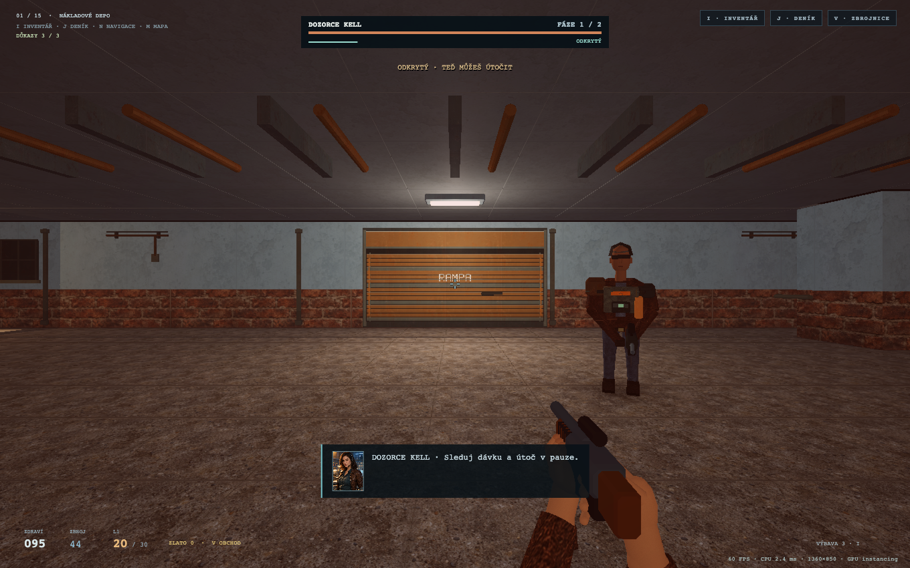

# HAVRAN / Iron Sector

[Česky](README.md) · English

A Czech-language story-driven 3D shooter developed iteratively with AI. Play Viktor Rys, enter the Vektor underground complex, collect evidence and work with Lea to uncover ORFEUS. Each of the 15 missions ends with a boss encounter.

This repository also documents how the author specified requirements, played the prototype, refined feedback and requested fixes and repeated testing. An AI assistant implemented the code, content and automated tests under that direction. The game interface and narrative are in Czech.

**[Download version 5.3](https://github.com/mikrofonek/havran-iron-sector/releases/tag/v5.3.0)** · **[Player guide](docs/PLAYING.en.md)** · **[Development and testing](docs/DEVELOPMENT.en.md)** · **[Original Czech prompts](docs/vyvoj/moje-zadani.md)**

## Run the game

1. Open Releases and download `havran-5-3-kampan.zip`.
2. Extract the entire archive.
3. Open `index.html`, select Classic or Apple Silicon GPU, and start the mission.

You need a desktop browser with WebGL, a keyboard and a mouse. The target platform is macOS. The extracted game works offline. Version 5.3 was measured on Apple M1 in Edge. Windows and Linux testing has not been documented. The repository ZIP from Code → Download ZIP is also runnable after extraction.

## Controls and objectives

Start each mission with a knife. Defeat the first guard and collect the dropped pistol with E. Find three evidence items, read them in inventory with I, use the terminal and enter the boss arena. After defeating the boss, reach the green exit.

| Input | Action |
| --- | --- |
| WASD / mouse | Move / look |
| Shift / Space | Sprint / jump |
| Left click / R | Fire or stab / reload |
| E / I | Collect or interact / inventory |
| 0 / mouse wheel | Knife / cycle acquired weapons |
| B / V / J | Flashlight / armory / journal |
| N / M | Optional route guidance / map |
| Esc | Pause and settings |

Settings include music and effects volume, crosshair color, sensitivity and field of view. Route guidance starts disabled. Progress between missions is stored in the browser. Use the backup and restore controls to move progress between variants or browsers. Restored missions start at their entrance.

## Development record

[Development and testing explained](docs/DEVELOPMENT.en.md) covers the author's role, AI implementation, changes between versions, test methods and fixes. The [68 original prompts and groups of screenshot comments](docs/vyvoj/moje-zadani.md) retain their Czech wording. [The development story](docs/vyvoj/pribeh-vyvoje.md) and [LinkedIn draft](docs/vyvoj/LINKEDIN.md) are also available.

The author initially requested more complex maps and an outdoor level, then simplified the routes and removed the outdoor mission after playing. All 15 missions in version 5.3 take place inside the complex.

## Verification

- 210 automated acceptance cases passed.
- 140 regression scenarios passed for each edition, giving 280 executions.
- 120 short browser performance cases passed.
- The portable runner passed 20 suites, including acceptance and regression.

The final performance run was recorded on 15 November 2026 in headless Edge 157, Apple M1 / ANGLE Metal, at 1440 × 900 with audio initialized. Short gameplay scenarios ran at about 60 FPS, with a worst per-case p95 frame callback interval of 16.8 ms. The briefing redraws its scene about ten times per second. These measurements cover one computer and short scenarios. Automated acceptance cases use actual game logic with controlled inputs. [Results and methodology](docs/DEVELOPMENT.en.md#testing).

## Development

With Node.js 20+, run `node havran-tests-5-3/run-tests.cjs`. Run `python3 scripts/package_release.py` to create downloadable archives in `dist/`. The browser benchmark additionally requires Playwright and Edge. Report problems through [Issues](https://github.com/mikrofonek/havran-iron-sector/issues), including the edition, mission, reproduction steps, browser and computer.

## Licensing and credits

The repository retains the [GNU LGPL 2.1 licence](LICENSE) chosen by its owner at creation. Asset provenance is documented in [CREDITS.txt](iron-sector/CREDITS.txt), [ART-NOTES.md](iron-sector/ART-NOTES.md) and the editions' `third-party` directories. Portraits and the material atlas were generated with AI. Music was procedurally created for the project. Geometry and game behavior are original HAVRAN implementations.
