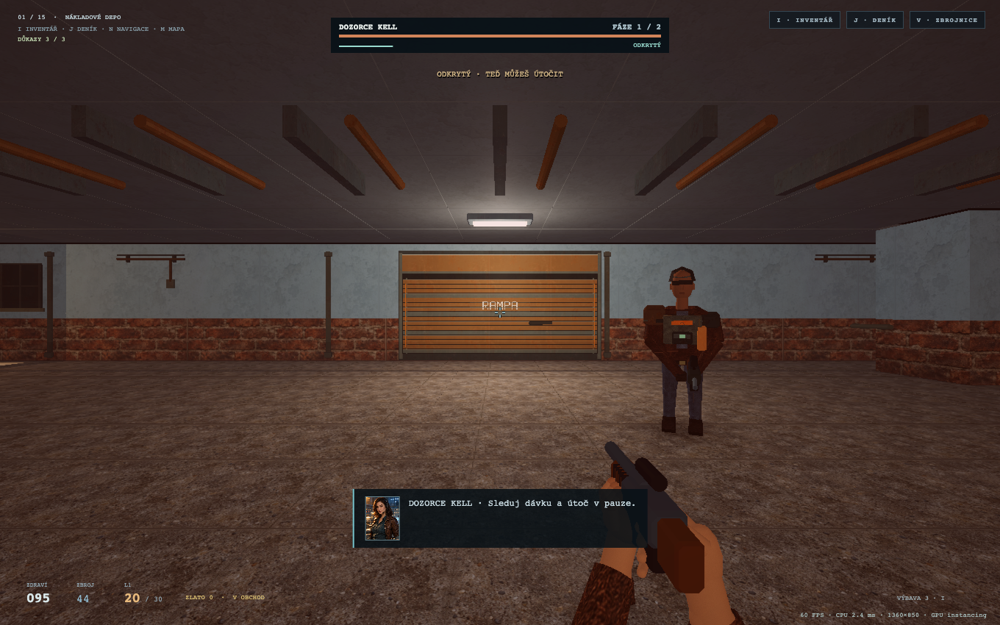

# HAVRAN / Iron Sector

Česky · [English](README.en.md)

Česká příběhová 3D střílečka vytvořená iterativním vývojem s AI. V roli Viktora Ryse sestupuješ do komplexu Vektor, sbíráš důkazy a s pomocí Ley odhaluješ systém ORFEUS. Každá z 15 misí končí soubojem s bossem.

Projekt dokumentuje, jak autor formuloval požadavky, hodnotil výsledek při hraní, upravoval zadání a požadoval opravy i opakované testování. Implementaci, podklady a automatizované testy vytvářel AI asistent podle jeho zadání.

**[Stáhnout vydání 5.3](https://github.com/mikrofonek/havran-iron-sector/releases/tag/v5.3.0)** · **[Návod pro hráče](docs/HRANI.md)** · **[Moje původní zadání](docs/vyvoj/moje-zadani.md)** · **[Jak hra vznikala](docs/vyvoj/POSTUP.md)**

## Spuštění

1. V části Releases stáhni `havran-5-3-kampan.zip`.
2. Rozbal celý ZIP.
3. Otevři `index.html`, vyber Classic nebo Apple Silicon GPU a stiskni „Zahájit misi“.

Hra potřebuje počítačový prohlížeč s WebGL, klávesnici a myš. Cílovou platformou je macOS. Po rozbalení ji lze hrát offline. Verze 5.3 byla měřena na Apple M1 v Edge. Testování na Windows a Linuxu zatím není doložené.

Pokud stahuješ repozitář přes **Code → Download ZIP**, celý jej rozbal a otevři kořenový `index.html`. Vývojové testy hráči nepotřebují.

## Jak hrát

Začni s nožem. Poraz první stráž a seber její zbraň přes **E**. Najdi tři důkazy, prohlédni je v inventáři přes **I** a použij terminál. Vstupem do arény začne boj s bossem. Po vítězství dojdi k zelenému východu.

| Ovládání | Akce |
| --- | --- |
| WASD / myš | Pohyb / rozhlížení |
| Shift / mezerník | Sprint / skok |
| Klik / R | Střelba nebo bodnutí / přebití |
| E / I | Sebrat nebo použít / inventář |
| 0 / kolečko myši | Nůž / přepnutí získaných zbraní |
| B / V / J | Baterka / zbrojnice / deník |
| N / M | Volitelná navigace / mapa |
| Esc | Pauza a nastavení |

Navigace se sama nezapíná. Nastavení obsahuje hlasitost hudby a efektů, citlivost myši, zorné pole i barvu zaměřovače. Postup se ukládá mezi misemi v prohlížeči. Pro přenos mezi variantami použij zálohu v menu.

## Jak vznikala

- [68 zadání a sad připomínek v původním pořadí](docs/vyvoj/moje-zadani.md), včetně textů komentářů ke snímkům.
- [Vývojový postup a rozdělení práce mezi autora a AI](docs/vyvoj/POSTUP.md).
- [Příběh vývoje v první osobě](docs/vyvoj/pribeh-vyvoje.md).
- [Jak jsem zpřesňoval zadání a testoval jednotlivé verze](docs/TESTOVANI.md).
- [Výsledky a podmínky testování](havran-tests-5-3/QA-5-3.md).
- [Návrh příspěvku na LinkedIn](docs/vyvoj/LINKEDIN.md).

Přepis vznikl z dostupné historie chatu. Obsahuje i požadavky, které se při hraní změnily. Například původně požadovanou venkovní misi autor později odstranil. Vydaná verze má všech 15 misí uvnitř komplexu.

## Ověření verze 5.3

| Sada | Výsledek |
| --- | --- |
| Automatizované UAT | 210 / 210 případů |
| Regrese | 140 scénářů na každou variantu, 280 úspěšných běhů |
| Výkon | 120 / 120 krátkých měření |
| Přenosné funkční sady | 20 / 20, včetně UAT a regrese |

Výkon byl měřen 15. listopadu 2026 v headless Edge 157, Apple M1 / ANGLE Metal, 1440 × 900 se zvukem. V krátkých scénářích hraní bylo přibližně 60 FPS, nejhorší p95 intervalu 16,8 ms. Úvodní menu překresluje scénu přibližně 10× za sekundu. Automatizované UAT používá skutečnou herní logiku a řízené vstupy. Podmínky a limity jsou v [QA zprávě](havran-tests-5-3/QA-5-3.md).

Výsledky zachycují uvedenou konfiguraci a rozsah. Dlouhodobý výkon na dalších počítačích vyžaduje další měření. Pro nahlášení problému použij [Issues](https://github.com/mikrofonek/havran-iron-sector/issues) a přilož kapitolu, postup, prohlížeč a model počítače.

## Pro vývojáře

S Node.js 20 nebo novějším spusť `node havran-tests-5-3/run-tests.cjs`. Příkaz `python3 scripts/package_release.py` vytvoří distribuční ZIPy do `dist/`. Výkonová sada má vlastní [návod](havran-tests-5-3/PERFORMANCE-5-3.md). [Přispívání a vydání](CONTRIBUTING.md).

## Licence a původ obsahu

V repozitáři je [GNU LGPL 2.1](LICENSE), kterou vlastník zvolil při založení. Původ zvuků, grafiky a dalších podkladů je v [CREDITS.txt](iron-sector/CREDITS.txt), [ART-NOTES.md](iron-sector/ART-NOTES.md) a složkách `third-party` jednotlivých variant. Portréty a atlas materiálů vznikly s generováním obrázků pomocí AI. Hudba byla procedurálně vytvořena pro projekt. Geometrie a chování jsou původní implementací HAVRANA.
